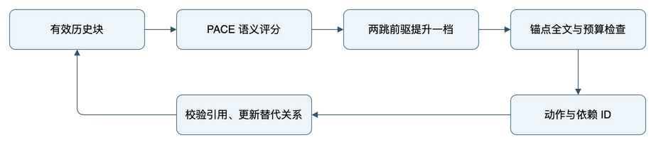

# DAG-PACE

DAG-PACE 在动作模型的同一次回复中记录依赖。下一轮先按 PACE 的语义相似度选出种子，再提升其依赖块的展示粒度。模型、网页工具、摘要和评分器与 PACE 共用。



## 改动集中在哪里

`src/dag_pace/strategy.py` 实现三项策略。每道题创建新的图，基线的 `agent.py` 负责在写入观察后通知策略，`context.py` 负责在算分前过滤、拼接前调用粒度调整。两组共用相同的预算检查。

1. **依赖。** 模型通过 `used_chunk_ids` 报告本次动作使用的历史块。新 TAO 的父节点包含这些 ID 和最近的工具块。只接受当前可见且早于新块的整数 ID。按余弦权重选两个旧块作为种子，两跳内的前驱去重后各提升一档。
2. **锚点。** 模型用 `critical_anchor_ids` 指定需保留原文的证据，可通过 `release_anchor_ids` 解除。超预算时先压缩普通块，再压缩非锚点的依赖块。锚点与最近全文仍放不下，轨迹记录 `budget_exceeded`。
3. **替代。** `supersedes_chunk_ids` 表示最近一条已看到的观察完整取代哪些旧块。旧块退出常规检索，依赖查找沿替代链找到当前版本。历史全文仍可通过 glimpse 按原 ID 恢复。

例如，当前已看到 C8，下一次访问依赖 C3 和 C8，可返回以下动作。执行工具后系统写入 C9 以及两条父边。ID 校验只检查引用是否合法，模型仍可能误判证据。

```json
{"tool":"visit","args":{"url":"https://example.org/schedule"},"note":"Check the schedule","used_chunk_ids":[3,8],"critical_anchor_ids":[3],"release_anchor_ids":[],"supersedes_chunk_ids":[]}
```

## 运行

Python 3.9+，只需标准库。与基线共用 `PACE/src/pace/providers/` 和本地 API 配置。动作、摘要和独立评分默认使用 `claude-sonnet-4-6`，向量使用 `GLM-Embedding-3`。先按 [PACE README](../PACE/README.md) 准备站点快照，再从 `DAG-PACE/` 运行：

```sh
export PYTHONPATH=src:../PACE:../PACE/src
python3 -m unittest discover -s tests -v
python3 benchmarks/run_paired.py --jobs 4
python3 -m benchmarks.report
```

`benchmarks/run_paired.py` 将策略传入共同评测入口。两组各完成一轮后，报告命令按同一道题配对汇总。完整轨迹保存在各自的 `results/paired20/`，其中 `metadata` 记录模型标记被接受后的状态，`adjustment` 记录种子、两跳前驱、锚点和预算检查前的提升，`shown` 是模型实际看到的粒度。[本组实测](experiments/paired20.md) · [逐题对照](experiments/comparison.md)

## 本轮结果

同一批 20 题，PACE 答对 11 题，DAG-PACE 答对 12 题。单源均为 6/10，多源从 5/10 到 6/10。总 token 从 778,399 增至 820,811（+5.4%）。每组每题仅跑一次。

- 第 50 题两组都找到 Online Trust & Safety Day。改进组把它作为直接答案，基线并列给出三个主题日，评分分别为对和错。
- 第 23 题改进组在三步内完成，全程没有旧块提档。两组答案都写出了参考答案中的教程标题，评分器对后续解释给了不同判断。第 262 题反向翻转，两组都找到了目标 workshop，但改进组并列列出另一项。
- 第 221 题两组均写出了官网新增的两节内容，评分器把超出参考答案的细节判错。逐题记录保留原始判分。两组都没有使用 glimpse，改进组也没有触发旧版本失活。本轮的净增一题还不足以确认依赖提升能稳定提高准确率。

## 四组消融 · 40 题

从仓库根目录运行。第一批 20 题沿用原有 PACE 和完整 DAG-PACE 轨迹。新增 20 题按站点轮流取样，单源、多源各 10 道。两批题单分别保存在 `PACE/benchmarks/paired20.json` 和 `additional20.json`。本机快照可直接复用；其他机器先按各题单的站点与快照名执行 PACE 的 `benchmarks.webwalkerqa prepare`。

```sh
export PYTHONPATH=PACE:PACE/src:DAG-PACE/src
python3 DAG-PACE/benchmarks/run_ablation.py paired20
python3 DAG-PACE/benchmarks/run_ablation.py additional20
python3 DAG-PACE/benchmarks/audit.py
python3 DAG-PACE/benchmarks/ablation_report.py
```

B 只请求 `used_chunk_ids`，C 增加锚点和解除锚点，D 再增加版本替代。关闭的模块会忽略模型自行输出的多余字段。每个组的结果按题保存，重跑同一命令会跳过已评分题。[准确率与 token](experiments/ablation40.md) · [逐题归因](experiments/ablation40-notes.md)
