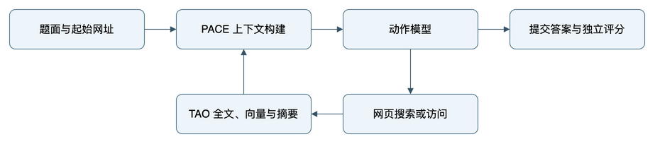

# PACE

PACE 在每次调用 agent 前，决定哪些历史交互需要全文、详细摘要、简短摘要或仅保留 ID。完整记录始终留在外部记忆中，agent 可用 `glimpse` 恢复原文。[论文](https://aclanthology.org/2026.acl-long.1252/)



## 快速运行

Python 3.9+。在 `PACE/` 下执行。离线示例与托管 benchmark 均只需标准库。托管版从环境变量 `PACE_API_KEY` 或本机私有的 `.local.json` 读取凭据，默认地址为 `https://api.labhuan.com/v1`。

```sh
export PYTHONPATH=src
python3 -m pace demo
python3 -m unittest discover -s tests -v
python3 -m pace run --encoder api --output results/smoke.json
```

WebWalkerQA 默认用 `claude-sonnet-4-6` 生成动作、两级摘要和评分，独立评分会话只看题目、参考答案和预测。向量来自 `GLM-Embedding-3`。单任务 CLI 的 `--encoder bge`（其默认值）使用本地 BGE-M3，需要另装 `requirements-bge.txt`。若有 NumPy，余弦计算使用矩阵乘法。

## 模块与数据流

| 路径 | 职责 |
|---|---|
| `src/pace/agent.py` | 执行一个工具动作，生成观察，将本轮 TAO 写入记忆，或用 finish 提交答案。 |
| `src/pace/memory.py` | 保留全文与向量，后台生成两级摘要，为 glimpse 提供全文。 |
| `src/pace/context.py`、`policy.py` | 将原问题和最近两块组成查询，对旧块算余弦和相对权重，按压力选粒度，最后按时间顺序拼接。 |
| `src/pace/providers/` | `api.py` 管理托管请求与 token 用量，`encoding.py` 管理向量和 token 估算。 |
| `benchmarks/` | 冻结站点、提供 search/visit、选择题目、执行与评分。逐步轨迹写入 `results/`。 |

旧块权重为 `M × softmax(cos / 0.3)`。压力根据步数和上一轮输入用量调节分档阈值。最近两块保留全文，已完成的摘要可供旧块降档。单次 glimpse 最多恢复三块。托管模式在请求前用 UTF-8 字节保守估算输入，服务端回传的输入 token 用于下一步压力计算。

## WebWalkerQA 20 题

在 `PACE/` 下执行。首次准备下载固定版题库与三个会议站点的网页。已有快照会复用，两组共用相同文件。ICSE 公开站点无 sitemap，从首页按层收集最多 120 个同站 HTML 页面。

```sh
export PYTHONPATH=src
python3 -m benchmarks.webwalkerqa prepare
python3 -m benchmarks.webwalkerqa prepare --root https://www2024.thewebconf.org/ --snapshot .cache/webwalkerqa/www2024.json
python3 -m benchmarks.webwalkerqa prepare --root https://www.icse-conferences.org/ --snapshot .cache/webwalkerqa/icse.json
python3 -m benchmarks.paired --jobs 4
```

[固定题单](benchmarks/paired20.json) 含 10 道单源及 10 道多源题。每题上限 16 步，输入预算 128,000。search 通过 BM25 返回最多 8 个页面标题和网址，visit 每次读取最多 4,200 字符。每题记录动作、展示粒度、答案、判分、分类用量和耗时。按原命令续跑会跳过已评分题。新采样应指定不同的 `--out`。[本组实测](experiments/paired20.md) · [两组对照](../DAG-PACE/experiments/comparison.md)

## 对照论文表 1

[配置核对](experiments/webwalkerqa-paper-check.md) · [Sonnet 4.6 六题三轮配对结果](experiments/webwalkerqa-paper-pilot.md)。两臂共用网页工具和裁判；PACE 使用本机 BGE-M3 INT8，ReAct 保留全部交互。运行条件、选题规则及与原论文的差异见配置核对。完成运行后，`PYTHONPATH=src .venv/bin/python -m benchmarks.paper_pilot_report` 可从原始轨迹重建结果表。

## 完整 WebWalkerQA main

完整题单有 680 题，单源和多源各 340 题。先检查 138 个公开站点的入口，再运行付费模型。下面的命令在 `PACE/` 下执行。

```sh
export PYTHONPATH=src
.venv/bin/python -m benchmarks.full_webwalker_preflight
.venv/bin/python -m benchmarks.webwalker_full run --arms pace --repeats 1 --jobs 6
.venv/bin/python -m benchmarks.webwalker_full report
```

可用 `--repeats 3` 追加第二、三轮，或用 `--arms pace react` 加入配对基线。每题从官方入口起步，search 对已发现的站内链接排序，visit 读取并按目标提取网页，支持继续发现链接。成功读取的页面在本机缓存。本模式的站内导航与论文的 Google + You.com 工具不同；网页版本也会影响得分。模型、步数上限、BGE 编码及上下文参数沿用六题试跑。

`results/webwalkerqa-full/` 保存入口检查、逐题答案、轨迹、用量和裁判结果。模型或裁判中断的题可用原命令续跑；访问错误保存在工具观察里，每轮收齐 680 个判分才输出全量准确率。试跑的六题结果独立保存。
